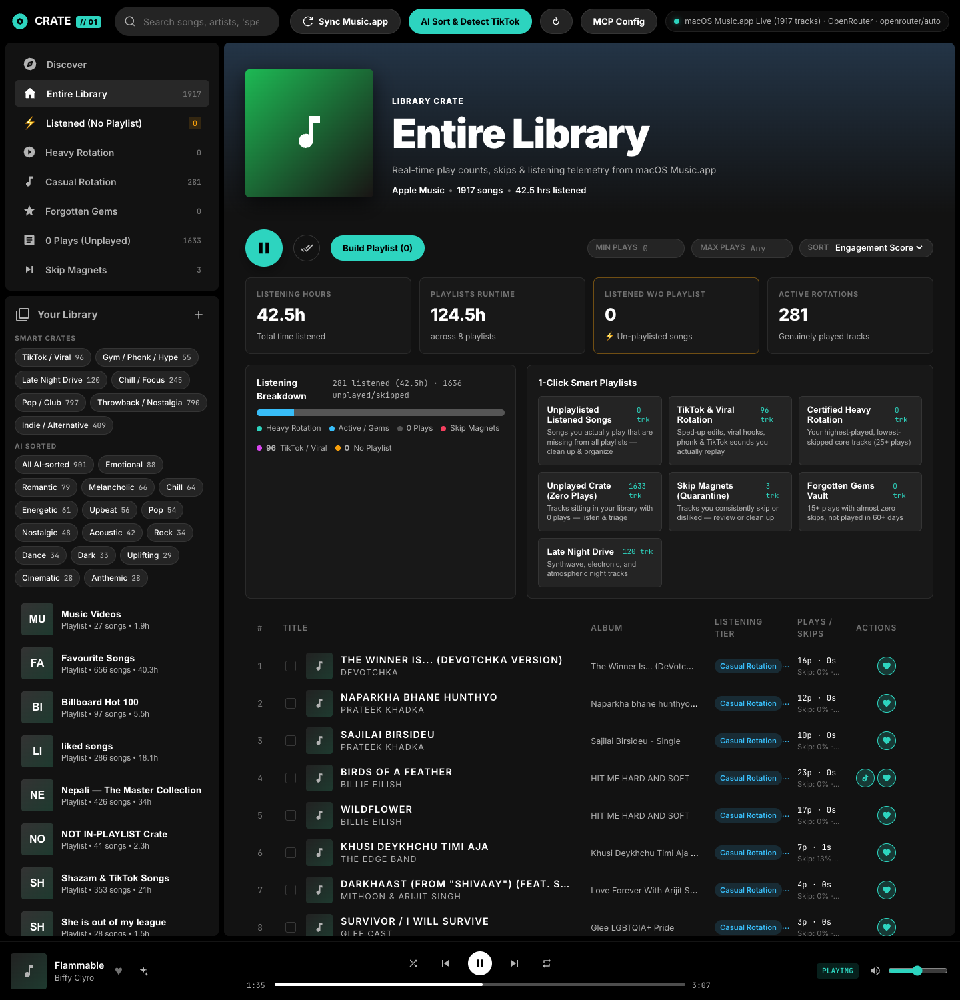
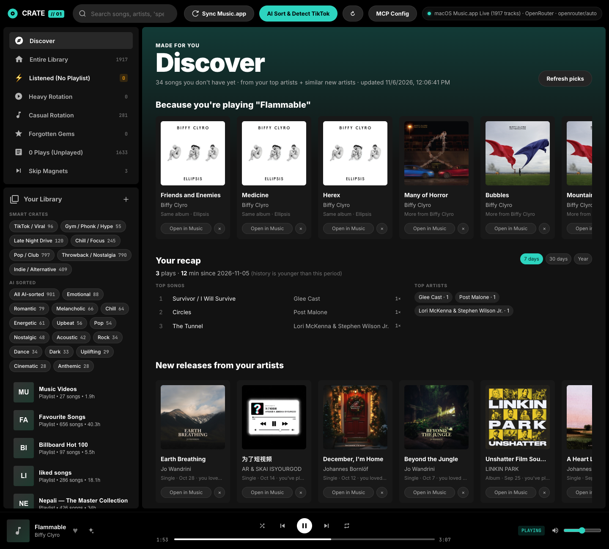

# CRATE // 01 — Apple Music Telemetry, Local Web Console & MCP Server

A local-only macOS **Apple Music (`Music.app`) management API, desktop-style web console, and Model Context Protocol (MCP) server**. Everything runs on your Mac; the server binds to `127.0.0.1` only.

CRATE directly bridges into macOS `Music.app` via JavaScript for Automation (JXA) and native AppleScript to extract exact play counts, skip counts, last-played timestamps, and track metadata—**without needing a \$99/year Apple Developer token**. It unifies your library across local files, cloud tracks, and playlists, analyzes listening habits (heavy rotation vs. skip magnets), detects TikTok/viral trends via heuristics and an optional AI model (Google Gemini, OpenRouter, OpenCode or any OpenAI-compatible API), and lets you manage and play your library through a web UI or your favorite AI agent.





---

## Table of Contents

- [Quick Start](#quick-start)
- [Architecture & Tech Stack](#architecture--tech-stack)
- [Web Console](#web-console)
- [Discover (Music Made For You)](#discover-music-made-for-you)
- [Listening Telemetry & Automated Tiers](#listening-telemetry--automated-tiers)
- [Deep Playlist Sync & Organization](#deep-playlist-sync--organization)
- [Model Context Protocol (MCP) Integration](#model-context-protocol-mcp-integration)
- [REST API Reference](#rest-api-reference)
- [AI Sound & Trend Classification](#ai-sound--trend-classification)
- [macOS Permissions & Troubleshooting](#macos-permissions--troubleshooting)
- [Project File Structure](#project-file-structure)

---

## Quick Start

### 1. Requirements
- **macOS** (Sonoma, Sequoia, or later recommended)
- **Apple Music (`Music.app`)** active and signed in
- **Node.js 18+**

### 2. Installation & Startup

```bash
# Clone and enter the repository
cd /path/to/apple-music-management

# Install dependencies
npm install

# Start the web console and API server
npm start
```

Open **`http://localhost:4321`** in your browser. Set `PORT` / `HOST` env vars to change the bind (default `127.0.0.1:4321`).

### 3. Run on a local domain with lerd (optional)

The repo ships a `.lerd.yaml` host-proxy config: lerd supervises `node src/server.js` on the Mac (it must run on the host, not in a container, to reach Music.app) and nginx serves it at **`https://crate.test`**.

```bash
lerd link --yes
```

macOS will ask once whether `node` may control **Music** — click **Allow**.

```bash
npm test   # tier/category logic self-check
```

---

## Architecture & Tech Stack

```
 ┌─────────────────────────────────────────────────────────────┐
 │                    CRATE Web Console                        │
 │            (Vanilla ES Modules, CSS3, DOM Chunking)         │
 └──────────────────────────────┬──────────────────────────────┘
                                │ HTTP / JSON
 ┌──────────────────────────────▼──────────────────────────────┐
 │                      Express 5 API Server                   │
 │                     (src/server.js :4321)                   │
 ├──────────────────────────────┬──────────────────────────────┤
 │   MCP Stdio Server           │   Categorization Service     │
 │   (src/mcp/server.js)        │   (src/services/categorizer) │
 └──────────────┬───────────────┴──────────────┬───────────────┘
                │                              │
                │ JXA / AppleScript Batching   │ AI provider (optional)
                ▼                              ▼
 ┌──────────────────────────────┐ ┌────────────────────────────┐
 │       macOS Music.app        │ │ Gemini / OpenRouter / OpenCode│
 │   (Local & Cloud Library)    │ │   (Structured JSON Output) │
 └──────────────────────────────┘ └────────────────────────────┘
```

- **Frontend**: Clean vanilla JavaScript (ESM) with zero UI runtime dependencies, with a dark theme (`#121212`, `#181818`, teal accent `#2dd4bf`). Uses `DocumentFragment` chunking and table-level event delegation to render thousands of tracks at 60fps without browser freezes.
- **Backend**: Express 5 on Node.js.
- **macOS Bridge**: Native JXA (`osascript -l JavaScript`) and AppleScript pipelines that communicate directly with Apple Music without external drivers.
- **AI Engine**: Hybrid categorization: instant offline regex/heuristic engine for viral sounds, plus an optional AI model (`src/services/ai.js`): Google Gemini via its SDK, or OpenRouter / OpenCode / any OpenAI-compatible `chat/completions` API with JSON-schema output.
- **MCP Server**: Stdio JSON-RPC server adhering to the Model Context Protocol standard, allowing tools to be invoked directly from Claude Desktop, Antigravity, Gemini CLI, Cursor, or any MCP-compatible agent.
- **Local Persistence**: `data/library-store.json` caches library telemetry, custom AI tags, user playlists, and analytics.

---

## Web Console

The web interface at `http://localhost:4321` (or your lerd domain, see below) is a three-pane desktop music layout:

### 1. Top Navigation Bar
- Pill search bar with debounced text search across titles, artists, albums, genres, and smart tags.
- Direct action buttons: **Sync Music.app**, **AI Sort & Detect TikTok** (classifies the whole library with your AI provider in batches of 60, with live progress; resumable, skips songs already done or tagged by hand), and the **MCP & AI Config** modal.
- Active macOS bridge connection LED with live track count and player state.

### 2. Left Sidebar ("Your Library")
- **Pinned Smart Crates** with live track counts:
  - **Entire Library**: Full collection view.
  - **⚡ Listened (No Playlist)**: Tracks you play that aren't saved in any playlist.
  - **Heavy Rotation**: High-play, low-skip core favorites.
  - **Casual Rotation**: Regular rotation tracks.
  - **Forgotten Gems**: Past favorites untouched for 60+ days.
  - **0 Plays (Unplayed)**: Backlog tracks sitting idle.
  - **Skip Magnets**: Highly skipped tracks.
- **Smart Crates Filter Chips**: *TikTok / Viral*, *Gym / Phonk / Hype*, *Late Night Drive*, *Pop / Club*, *Throwback / Nostalgia*, *Indie / Alternative*.
- **Your Playlists**: Playlist cards with two-letter initials cover artwork, song counts, and runtime hours.

### 3. Workspace & Dynamic Hero
- Dynamic gradient background computed from the playlist/crate title.
- High-res cover container, playlist title, runtime hours, and song counts.
- **Big Play Button**: Plays the playlist in `Music.app` or kicks off playback of the currently filtered view.
- Granular sort dropdown (Engagement Score, Most Played, Zero Plays, Skip %, Recently Played, Alphabetical) and play-count filters.

### 4. Telemetry & Analytics Dashboard (Shown in Library Mode)
- **4 Key Performance Indicators (KPIs)**:
  - **Listening Hours**: Cumulative hours spent listening.
  - **Playlists Runtime**: Total duration across all playlists.
  - **Listened w/o Playlist**: Songs you listen to that are missing from playlists (click to filter).
  - **Active Rotations**: Count of genuinely played tracks.
- **Split Ratio Meter**: Visual breakdown of your library (Heavy Rotation, Casual, Unplayed Backlog, Skip Magnets).
- **1-Click Smart Playlist Generators**: One-click generation of Apple Music playlists from predefined smart recipes.

### 5. High-Performance 8-Column Track Table
- Index (`#`) column with white play triangle (`▶`) on hover.
- Double-clicking any track immediately starts playback in `Music.app`.
- Columns: `#`, `Title & Artist`, `Album`, `Listening Tier`, `Plays / Skips` (with skip % & engagement score), `Last Played` (relative dates: *Today*, *Yesterday*, *3d ago*), `Smart Tags / AI Reason`, and `Quick Actions` (Play, TikTok flag, Apple Music Heart/Loved, Dislike/Skip).

### 6. Bottom Fixed Now-Playing Dock
- **Left Dock**: Current song thumbnail, title, artist, and heart toggle.
- **Center Transport Controls**: Shuffle, Previous, Play/Pause, Next, Repeat (off → all → one), and a click-to-seek progress rail. The dock polls Music.app every 3s.
- **Right Dock**: Real-time player state badge (`PLAYING` / `PAUSED`) and a volume slider that sets Music.app's volume.

---

## Discover (Music Made For You)

Click **Discover** at the top of the sidebar for new songs you don't have yet, picked from your own listening:

1. **Taste profile**: artists and genres are ranked by plays (loved songs count 1.5×), minus 2 per skip; disliked tracks are ignored. The top artists and genres show as chips.
2. **More from your artists**: Apple's public catalog search (`itunes.apple.com/search`, no key) finds songs by your top 6 artists that aren't in your library (matched by title + lead artist, ignoring "(feat.)", "(Remastered)" etc.).
3. **New artists for you** *(needs an AI key)*: the AI suggests artists similar to your taste that you don't have, and their top songs are looked up the same way.

**Because you're playing…** sits at the top of Discover (or click ✦ in the player bar). It's seeded by whatever Music.app is playing and updates as shuffle moves on: songs from the same album, more by that artist, and songs by artists who share your playlists with it (your own curation as the "fans also like" signal), plus AI-suggested similar artists when a key is set. The playing song itself is never suggested.

Each card has a 30-second **preview** (plays in the browser), **Open in Music** (shows the song in Music.app, where you click **+** to add it; Apple doesn't allow scripts to add catalog songs), and **×** (never suggest it again).

**Your recap** shows your top songs, top artists and first listens for the last 7 days, 30 days or year. Music.app only keeps lifetime play counts, so CRATE saves one snapshot of them per day (`data/play-history.json`, after each sync plus an automatic hourly check) and diffs them. History starts from your first snapshot, so the recap fills in as you listen. Click a song to play it.

**New releases from your artists** lists singles, EPs and albums from the last 6 months by your top 20 artists (by plays and loves) that aren't already in your library. It also includes collabs that turn up on those artists' pages.

Results are cached for 12 hours; **Refresh picks** searches again. The catalog storefront defaults to `us`; set `DISCOVERY_COUNTRY=np` (or any two-letter code) to use yours.

---

## Listening Telemetry & Automated Tiers

CRATE calculates an **Engagement Score** ($0 - 100$) for every track based on play velocity, skip frequency, and recency:

$$\text{Skip Ratio} = \frac{\text{skippedCount}}{\text{playedCount} + \text{skippedCount}}$$

### Listening Tiers

Evaluated top to bottom; first match wins.

| Tier Key | Tier Label | Criteria |
| :--- | :--- | :--- |
| `skip-magnet` | **Skip Magnets (Don't Listen)** | `disliked`, or `skippedCount >= 3` and (`skippedCount > playedCount` or `skipRatio >= 0.45`) |
| `unplayed-backlog`| **Never Listened (0 Plays)** | `playedCount === 0` |
| `forgotten-gems` | **Forgotten Gems** | `playedCount >= 15`, `skipRatio < 0.25`, and `daysSinceLastPlayed >= 60` |
| `heavy-rotation` | **Heavy Rotation** | `playedCount >= 25` and `skipRatio < 0.25` |
| `casual-rotation` | **Casual Rotation** | everything else |
| `not-in-playlist` | **Listened (No Playlist)** | filter, not a tier: `playedCount > 0` and not in any user playlist |

---

## Deep Playlist Sync & Organization

### Resolving Apple Music Cloud vs. Library Separation
In macOS `Music.app`, streaming songs added directly to playlists do not always appear in the main library (`music.libraryPlaylists[0]`). CRATE solves this by querying **both** `libraryPlaylists[0]` **and** all `userPlaylists()`, capturing all unique tracks and persistent IDs across your entire Apple Music account.

### Automated Deduping & Playlist Unification
Using CRATE's MCP tools or REST API, you can easily clean up fragmented playlists:
- **Nepali Master Collection**: Unified 6 scattered playlists into 1 clean playlist of 426 unique songs, stripping 155 duplicate tracks.
- **Shazam & TikTok Songs**: Merged 7 overlapping playlists into a single collection of 353 tracks, deleting redundant crates.
- **Favourites vs. Liked Separation**: Cleaned `liked songs` by removing tracks already in `Favourite Songs` (Apple Music's native smart playlist driven by the `favorited` flag), preserving unique liked songs without duplicate bloat.

---

## Model Context Protocol (MCP) Integration

The built-in MCP server exposes 11 tools to manage your Apple Music library through natural language in AI assistants.

### MCP Configuration

Add the following to your AI client configuration (e.g. `claude_desktop_config.json`, `~/.gemini/antigravity/mcp_config.json`, or Cursor MCP settings):

```json
{
  "mcpServers": {
    "apple-music-manager": {
      "command": "node",
      "args": [
        "/absolute/path/to/apple-music-management/src/mcp/server.js"
      ]
    }
  }
}
```

### Available MCP Tools

| Tool Name | Description | Key Arguments |
| :--- | :--- | :--- |
| `get_listening_analytics` | Returns library metrics, listening hours, tier counts, and smart recipes. | *(none)* |
| `search_and_filter_tracks` | Filter and sort tracks by tier, category, plays, skips, or search query. | `tier`, `category`, `search`, `min_plays`, `max_plays`, `min_skips`, `not_played_in_days`, `sort`, `limit` |
| `categorize_tracks_ai` | Classify tracks with the configured AI provider (skips done/manual). | `track_ids`, `custom_prompt` |
| `list_playlists` | Returns all playlists with track counts, durations, and listened hours. | *(none)* |
| `create_playlist_from_tracks` | Creates a new playlist in macOS `Music.app` with specific persistent IDs. | `name` (required), `description`, `track_persistent_ids` |
| `create_smart_playlist` | Generates a playlist from a recipe (`unplaylisted-listened`, `tiktok-viral`, etc.) or `custom` filters. | `recipe_id` (required), `custom_name`, `category`, `min_plays`, `max_plays` |
| `modify_playlist_tracks` | Add or remove tracks from an existing Apple Music playlist (adds skip tracks already present). | `playlist_id_or_name` (required), `action` (`add`\|`remove`), `track_persistent_ids` |
| `delete_playlist` | Deletes a playlist from macOS `Music.app`. | `playlist_id_or_name` (required) |
| `update_track_tags` | Update tags on a track. | `track_id` (required), `is_tiktok`, `categories`, `favorited`, `disliked`, `comment` |
| `discover_music` | New catalog songs you don't own, picked from your taste (with music.apple.com links). | `refresh` |
| `control_playback` | Play a track/playlist, toggle, next/prev, shuffle, repeat, volume, seek, or read status. | `action` (`play-track`\|`play-playlist`\|`toggle`\|`play`\|`pause`\|`next`\|`previous`\|`shuffle`\|`repeat`\|`volume`\|`seek`\|`status`), `target` |

---

## REST API Reference

### Library & Status
- **`GET /api/status`**: Bridge connection status, now playing track, and analytics overview.
- **`POST /api/sync`**: Force a fresh sync from macOS `Music.app`.
  - Body: `{ "forceDemo": false }`
- **`GET /api/analytics`**: Detailed breakdown of listening hours, tiers, and smart recipes.
- **`POST /api/settings`**: Save AI settings: `aiProvider` (`gemini` \| `openrouter` \| `opencode` \| `custom`), `aiApiKey` (empty keeps the saved key), `aiModel` (empty = provider default), `aiBaseUrl` (custom only). `clearAiKey: true` removes it.
- **`POST /api/categorize`** / **`GET /api/categorize/status`**: Start the AI sort in the background / poll its progress.

### Tracks
- **`GET /api/tracks`**: Retrieve and filter library tracks.
  - Query parameters:
    - `playlistId`: Filter to tracks in a specific playlist
    - `tier`: `heavy-rotation`, `casual-rotation`, `not-in-playlist`, `forgotten-gems`, `unplayed-backlog`, `skip-magnet`
    - `category`: Filter by genre or AI tag
    - `search`: Keyword search across title, artist, album, genre, comment
    - `minPlays`, `maxPlays`, `minSkips`: Numeric thresholds
    - `sort`: `engagement-desc`, `plays-desc`, `plays-asc`, `skips-desc`, `skip-ratio-desc`, `recent-desc`, `name-asc`
- **`PATCH /api/tracks/:id`**: Update custom tags or toggle favorite/dislike.
  - Body: `{ "isTikTok": true, "categories": ["TikTok / Viral"], "favorited": true }`

### Playlists
- **`GET /api/playlists`**: Returns all playlists with track counts and runtime hours.
  - Query parameters: `includeTracks=true` (optional, default: `false`)
- **`POST /api/playlists`**: Create a new playlist in `Music.app`.
  - Body: `{ "name": "Summer 2026", "description": "Curated with CRATE", "trackPersistentIds": ["..."] }`
- **`POST /api/playlists/smart-generate`**: Create a playlist from a recipe.
  - Body: `{ "recipeId": "unplaylisted-listened" }`
- **`POST /api/playlists/:id/tracks`** / **`DELETE /api/playlists/:id/tracks`**: Add / remove tracks (`{ "trackPersistentIds": ["..."] }`).
- **`DELETE /api/playlists/:id`**: Delete a playlist by ID or persistent ID.

### Discover
- **`GET /api/discover`**: Taste profile + recommended catalog songs (`?refresh=1` skips the 12h cache).
- **`GET /api/discover/now-playing`**: Picks seeded by the song Music.app is playing now.
- **`POST /api/discover/:catalogId/dismiss`**: Never suggest this song again.
- **`GET /api/releases`**: Recent releases (6 months) from your top 20 artists that you don't own (`?refresh=1` skips the 12h cache).
- **`GET /api/recap?days=7`**: Plays, minutes, top songs/artists and first listens over the period, from daily play-count snapshots.
- **`POST /api/discover/open`**: Open a `music.apple.com` link in Music.app (`{ "url": "https://music.apple.com/..." }`); other URLs are rejected.

### Playback Transport
- **`POST /api/player/play-track`**: Play a track by persistent ID (`{ "target": "26FF44FB6C22E03B" }`).
- **`POST /api/player/play-playlist`**: Play a playlist by name (`{ "target": "Nepali — The Master Collection" }`).
- **`POST /api/player/toggle`**: Toggle play/pause.
- **`POST /api/player/next`**: Skip to the next track.
- **`POST /api/player/previous`**: Return to the previous track.
- **`POST /api/player/shuffle`** / **`POST /api/player/repeat`**: Toggle shuffle / cycle repeat (off → all → one).
- **`POST /api/player/volume`**: Set volume (`{ "target": 60 }`).
- **`POST /api/player/seek`**: Seek to seconds (`{ "target": 90 }`).
- **`POST /api/player/status`**: Live player state, now playing, position, volume, shuffle, repeat.

---

## AI Sound & Trend Classification

CRATE features a dual-layer categorization system:

1. **Local Heuristic Matcher**:
   - Detects viral sound markers: `sped up`, `slowed + reverb`, `phonk`, `nightcore`, `hyperpop`, `remix`, `edit`.
   - Flags viral TikTok and gym workout tracks instantly without external API calls or network latency.

2. **AI provider** *(optional, set in MCP Config)*:

   | Provider | Key from | Default model |
   | :--- | :--- | :--- |
   | Google Gemini | aistudio.google.com | `gemini-3.8-flash` |
   | OpenRouter | openrouter.ai/keys | `openrouter/auto` |
   | OpenCode | opencode.ai (Console) | `kimi-k2.6` |
   | OpenAI-compatible | any `…/v1/chat/completions` API | (you choose) |

   Leave the model blank for the default, or type any model the provider offers. Requests are paced (one per 13s for Gemini's free tier, 3s otherwise; override with `AI_MIN_GAP_MS`) and retried on 429/5xx. Models that reject JSON-schema mode get the schema in the prompt instead. Env fallbacks: `OPENROUTER_API_KEY`, `GEMINI_API_KEY`.

---

## macOS Permissions & Troubleshooting

### Apple Events Permission
On first run, macOS will prompt you to allow your terminal (Terminal, iTerm, VS Code, or Antigravity) to control **Music.app**. Click **Allow**.

If permissions were denied or need reset:
1. Open **System Settings > Privacy & Security > Automation**.
2. Locate your terminal application and ensure **Music** is toggled **ON**.
3. To reset permissions via terminal:
   ```bash
   tccutil reset AppleEvents com.apple.Music
   ```

### Node.js Path
If running from an MCP client or system daemon where `node` is not in `/usr/bin`, provide the absolute path to your Node binary in your MCP config (e.g. `/Users/<username>/.vite-plus/bin/node` or `~/.nvm/versions/node/<ver>/bin/node`).

---

## Project File Structure

```
apple-music-management/
├── data/
│   ├── library-store.json       # Local library cache (1,934+ tracks & playlists)
│   └── liked-songs-backup.json  # Backup snapshot of liked songs
├── public/
│   ├── app.js                   # Console client logic & event delegation
│   ├── index.html               # Desktop shell & semantic DOM
│   └── styles.css               # Theme design tokens & styles
├── src/
│   ├── bridge/
│   │   └── appleMusicBridge.js  # JXA & AppleScript Music.app automation bridge
│   ├── mcp/
│   │   └── server.js            # Model Context Protocol stdio server (10 tools)
│   ├── services/
│   │   ├── ai.js                # AI provider layer (Gemini / OpenRouter / OpenCode / custom)
│   │   ├── categorizer.js       # Telemetry scoring, tiers, and AI classifiers
│   │   ├── discovery.js         # Taste profile, catalog recommendations, new releases
│   │   └── history.js           # Daily play-count snapshots + recap
│   └── server.js                # Express REST API server (:4321)
├── package.json
└── README.md
```

---

## License

MIT License — Feel free to customize and extend for your own personal music workflows!
